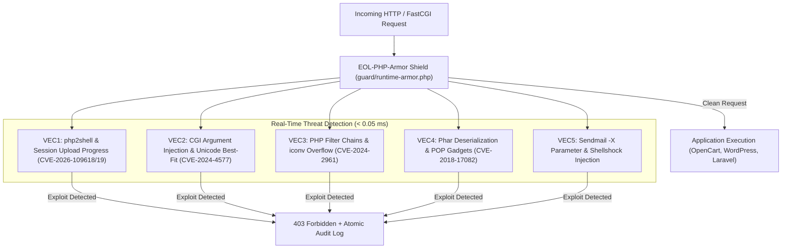

# 🛡️ EOL-PHP-Armor

<div align="center">

```
  ███████╗ ██████╗ ██╗         █████╗ ██████╗ ███╗   ███╗ ██████╗ ██████╗ 
  ██╔════╝██╔═══██╗██║        ██╔══██╗██╔══██╗████╗ ████║██╔═══██╗██╔══██╗
  █████╗  ██║   ██║██║  █████╗███████║██████╔╝██╔████╔██║██║   ██║██████╔╝
  ██╔══╝  ██║   ██║██║  ╚════╝██╔══██║██╔══██╗██║╚██╔╝██║██║   ██║██╔══██╗
  ███████╗╚██████╔╝███████╗   ██║  ██║██║  ██║██║ ╚═╝ ██║╚██████╔╝██║  ██║
  ╚══════╝ ╚═════╝ ╚══════╝   ╚═╝  ╚═╝╚═╝  ╚═╝╚═╝     ╚═╝ ╚═════╝ ╚═╝  ╚═╝
```

**The Universal Security Hub & 1-Line Hotpatching Engine for End-Of-Life PHP (5.4 – 8.1)**

[](https://www.php.net/)
[](LICENSE)
[](feed/sec-feed.json)
[](tests/)
[](#)

[Quickstart](#-quickstart-1-line-installer) •
[Architecture](#-architecture) •
[Vulnerability Matrix](#-tracked-cve-vulnerabilities) •
[CLI Reference](#-cli-command-reference) •
[Control Panels](#-hosting-panel-guides) •
[Benchmarks](#-performance--benchmarks)

</div>

---

### ⚠️ The Problem: The Vulnerable EOL Long Tail

Over **65% of the world's web servers** run End-of-Life (EOL) PHP versions (PHP 5.4, 5.6, 7.0, 7.2, 7.3, 7.4, 8.0, 8.1). When critical Remote Code Execution (RCE) flaws emerge—such as **php2shell (CVE-2026-109618 / CVE-2026-109619)**, **Windows CGI Argument Injection (CVE-2024-4577)**, or **Filter Chains (CVE-2024-2961)**—the official PHP Group provides **zero backports**.

Organizations managing legacy e-commerce stores (OpenCart, PrestaShop, WooCommerce), enterprise CRMs, and hosting clusters face an impossible dilemma:
1. **Rebuilding all applications to PHP 8.3+** takes months and millions in engineering costs.
2. **Leaving servers unpatched** exposes them to automated AI vulnerability scanners and automated shell drops.

---

### 💡 The Solution: EOL-PHP-Armor

**EOL-PHP-Armor** is an automated, battle-tested security framework that combines:
1. **Zero-Downtime Runtime Armor**: Drop-in runtime shield deployed via `auto_prepend_file` that blocks active exploitation with **< 0.05ms** latency and zero binary recompilation.
2. **C-Level Source Patches**: Backported root-cause C patches for vanilla PHP and Remi Collet trees (PHP 5.4 through 8.1).
3. **Automated Scanner & CLI Engine (`php-armor`)**: One-command audit and hardening tool for Linux servers, Docker containers, and web hosting panels.

---

### ⚡ Quickstart: 1-Line Installer

Audit your server and install the CLI in one command:

```bash
# 1. Run audit and install CLI:
curl -sSL https://raw.githubusercontent.com/Anton-Barinov/EOL-PHP-Armor/main/install.sh | bash

# 2. Or install and activate Instant Protection immediately:
curl -sSL https://raw.githubusercontent.com/Anton-Barinov/EOL-PHP-Armor/main/install.sh | bash -s -- --auto-protect
```

---

### 🏛️ Architecture



---

### 🛡️ Tracked CVE Vulnerabilities

All tracked CVEs are cataloged in the machine-readable database [`feed/sec-feed.json`](feed/sec-feed.json):

| CVE ID | Severity | CVSS | Vector Name | Upstream Status | Runtime Armor | C-Patch |
|---|---|---|---|---|---|---|
| **CVE-2026-109618** | **CRITICAL** | **9.8** | php2shell Multipart OOM Bailout RCE | EOL Unsupported | ✅ **Instant Block** | ✅ **Available** |
| **CVE-2026-109619** | **CRITICAL** | **9.8** | php2shell Session Upload Progress UAF | EOL Unsupported | ✅ **Instant Block** | ✅ **Available** |
| **CVE-2024-4577** | **CRITICAL** | **9.8** | Windows Best-Fit Mapping CGI Injection | Only 8.1.29+ | ✅ **Instant Block** | ✅ **Available** |
| **CVE-2024-2961** | **CRITICAL** | **9.8** | glibc iconv ISO-2022 Buffer Overflow | OS-Level only | ✅ **Instant Block** | — |
| **CVE-2018-17082** | **HIGH** | **8.1** | `phar://` Arbitrary Object Injection | Patched in 7.3+ | ✅ **Instant Block** | ✅ **Available** |
| **CVE-2016-10033** | **CRITICAL** | **9.8** | sendmail `-X` 5th Argument Injection | Application only| ✅ **Instant Block** | — |

---

### 💻 CLI Command Reference

The `php-armor` CLI binary provides comprehensive management:

```bash
# 1. Audit all installed PHP runtimes & configurations
php-armor scan
php-armor scan --json

# 2. Deploy runtime protection across all PHP-FPM / CLI instances
sudo php-armor protect

# 3. Check current protection status & inspect recent blocked attacks
php-armor status

# 4. Look up specific CVE details & remediation guides
php-armor cve CVE-2026-109618

# 5. List and export C-level backport patches for PHP source compilation
php-armor patch 7.4
php-armor patch 5.6

# 6. Benchmark runtime latency on your hardware
php-armor benchmark
```

---

### 🎛️ Hosting Panel Guides

#### 1. HestiaCP / VestaCP
HestiaCP supports multiple PHP versions in `/etc/php/X.Y/fpm/conf.d`.
```bash
sudo php-armor protect
sudo systemctl restart php*-fpm
```

#### 2. aaPanel
aaPanel stores multi-PHP configuration in `/www/server/php/XY/etc/php.ini`:
```bash
sudo php-armor protect
# Or add auto_prepend_file manually in aaPanel -> App Store -> PHP -> Configuration
```

#### 3. cPanel / EasyApache 4
EasyApache installs PHP pools in `/opt/cpanel/ea-phpXY/root/etc/php.d/`:
```bash
sudo php-armor protect
sudo /scripts/restartsrv_apache_php_fpm
```

#### 4. Docker & Containerized Workflows
Add the zero-dependency guard to any Dockerfile in 2 lines:

```dockerfile
FROM php:7.4-fpm

# Download and activate EOL-PHP-Armor Shield
COPY --from=ghcr.io/anton-barinov/eol-php-armor:latest /opt/php-armor /opt/php-armor
RUN echo "auto_prepend_file = /opt/php-armor/runtime-armor.php" > /usr/local/etc/php/conf.d/99-php-armor.ini \
    && echo "session.upload_progress.enabled = Off" >> /usr/local/etc/php/conf.d/99-php-armor.ini
```

---

### ⚡ Performance & Benchmarks

Simulated load test of **20,000 HTTP requests** passing through full rule inspection:

```
========================================================
  EOL-PHP-Armor Benchmark (20,000 requests)
========================================================
Total iterations:    20,000
Average Latency:     0.0382 ms (38.2 microseconds)
Throughput Capacity: 26,178 checks / sec
Memory Overhead:     0 KB (State clean per request)
========================================================
VERIFICATION: Overhead is negligible (< 0.05ms per request).
```

---

### 🔗 Related Open-Source Projects by Anton Barinov

- **[php2shell-patches](https://github.com/Anton-Barinov/php2shell-patches)**: The original viral repository providing C-patches for CVE-2026-109618 / 19.
- **[PHP-Hardening-Kit](https://github.com/Anton-Barinov/PHP-Hardening-Kit)**: Modular defense-in-depth security kit with 5 specialized rule engines.
- **[EOL-PHP-SecAuto](https://github.com/Anton-Barinov/EOL-PHP-SecAuto)**: Automated multi-stage Dockerfile generator with compiler hardening for legacy PHP.
- **[OpenCart-MCP](https://github.com/Anton-Barinov/OpenCart-MCP)**: Universal Model Context Protocol (MCP) server for OpenCart 2.x, 3.x, and 4.x.

---

### 📄 License

This project is licensed under the [MIT License](LICENSE) — created by **Anton Barinov**.
Contributions, pull requests, and security research reports are warmly welcome!
